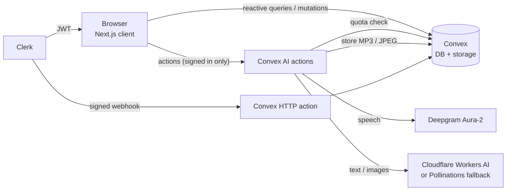

# 🎙️ Groei: AI Podcast Studio

**Turn any idea into a published podcast in minutes.** Groei writes the script with an LLM, reads it aloud in a natural AI voice, generates cover art, and publishes it to a real-time podcast platform with search, creator profiles and a persistent audio player.

All of the AI runs on free tiers or free credit, so the app costs **$0 to run**.

## ✨ Features

**Creating**
- **AI scriptwriter:** describe a topic, pick a tone and length, and an LLM writes a script ready to be read aloud.
- **6 natural AI voices** (Deepgram Aura-2), female and male, American and British, each with a one-click preview.
- **AI cover art:** FLUX generates a thumbnail. You can also have the AI suggest a prompt from your title, or drag and drop your own image.
- **Guided four-step flow:** a live readiness checklist, character counters, stale-audio detection, and a warning before you leave with unsaved work.
- **Daily usage quotas** for each user keep the shared free AI budget fair.

**Listening**
- **Persistent global player** that keeps playing across page navigation. It has seek, ±10 s skip, playback speed (0.75×–2×), volume and mute, and remembers your settings.
- **OS media controls** (lock screen, headset buttons, media keys) via the Media Session API, plus the space bar to play/pause.
- **Play counts:** each listen is counted once per session, and they drive the *Trending* ranking.

**Browsing**
- Home page with *Trending* and *Latest* sections, real-time full-text **search** (title, creator, description) with shareable URLs, and paginated **Discover**.
- **Creator profiles** with total plays and "play random", a "Fans like you" carousel, and a "Top podcasters" leaderboard.
- **Likes** (instant, optimistic UI) and a personal "Liked podcasts" library.
- **Comments** that update in real time, with a creator badge, delete permissions for the commenter and the podcast owner, and simple spam protection.
- Owners can **edit** or **delete** their podcasts. Deleting also removes the stored audio and image.
- **Polished auth:** split-screen sign-in and sign-up pages themed with Clerk's dark theme, and a mobile bottom tab bar.
- **Social sharing**, with server-rendered Open Graph metadata for every podcast and profile.
- Responsive from phones to wide screens, with skeleton loading states, error boundaries and not-found pages.

## 🧱 Tech stack

| Layer | Tech |
| --- | --- |
| Frontend | Next.js 14 (App Router), React 18, TypeScript, Tailwind CSS, shadcn/ui and Radix |
| Backend | [Convex](https://convex.dev): reactive database, file storage, serverless functions, cron jobs |
| Auth | [Clerk](https://clerk.com), with a webhook sync and a client-side fallback |
| Voice | [Deepgram Aura-2](https://developers.deepgram.com/docs/text-to-speech): $200 free credit, no card |
| Scripts and art | [Cloudflare Workers AI](https://developers.cloudflare.com/workers-ai/) (Llama 3.1, FLUX.1 schnell), with automatic fallback to [Pollinations](https://pollinations.ai), which needs no key |
| Forms | react-hook-form and zod |

## 🏗️ Architecture



**Design decisions**

- **Every write is authorized on the server.** Each mutation and action checks the Clerk identity. Podcasts can only be edited or deleted by their owner, and only the owner of a generated or uploaded file can attach it to a podcast. The `files` table records who owns each storage object.
- **AI output never passes through the browser.** Actions store generated audio and images directly in Convex storage and return only the ID and URL. This avoids payload limits and keeps API keys on the server.
- **Free-tier friendly.** Quotas are per user per day, and quota is refunded automatically when the AI provider fails. Long scripts are split at sentence boundaries and the MP3 pieces are joined. Voice previews are generated once and then cached.
- **Self-cleaning storage.** Replaced drafts are discarded right away, and an hourly cron deletes files that were never attached to a podcast.
- **Robust user sync.** A signed Clerk webhook keeps profiles up to date, and a `users.store` mutation creates or syncs the profile on sign-in, so the app works even before the webhook arrives.
- **Graceful degradation.** Image and text generation fall back to a provider that needs no key, and the UI checks which AI features are configured so it can explain missing setup instead of failing.
- **Counters stored on each podcast.** Like and comment totals live on the podcast, so lists never count rows on read. Deletes cascade and keep the counters correct.
- **Indexed queries throughout:** `by_clerkId`, `by_authorId`, `by_views`, `by_voiceType`, plus three search indexes. No full-table scans on hot paths.
- **Public browsing, protected creation.** Anyone can explore and listen, and only `/create-podcast` requires sign-in.
- **No unnecessary re-renders.** The audio engine lives in a context provider, with playback progress in a separate context, so the per-second time updates don't re-render every podcast card.

## 🚀 Getting started

### 1. Install

```bash
npm install
```

### 2. Convex

```bash
npx convex dev   # logs in, creates a deployment, writes .env.local, and watches convex/
```

### 3. Clerk

1. Create an application at [clerk.com](https://dashboard.clerk.com). Copy the publishable and secret keys into `.env.local` (see `.env.example`).
2. **JWT template:** go to *Configure → JWT templates → New → Convex*, keep the name `convex`, and copy the **Issuer** URL:
   ```bash
   npx convex env set CLERK_JWT_ISSUER_DOMAIN https://<your-instance>.clerk.accounts.dev
   ```
3. **Webhook (optional, recommended):** go to *Configure → Webhooks → Add endpoint*, set the URL to `https://<your-deployment>.convex.site/clerk`, and subscribe to `user.created`, `user.updated` and `user.deleted`. Then:
   ```bash
   npx convex env set CLERK_WEBHOOK_SECRET whsec_...
   ```

### 4. Deepgram voices (required for audio)

1. Sign up at [console.deepgram.com](https://console.deepgram.com/signup). You get $200 of free credit with no card, which covers about 6.6 million characters with Aura-2.
2. Go to *API Keys → Create a New API Key* and copy the key.
3. Store it in Convex:
   ```bash
   npx convex env set DEEPGRAM_API_KEY <key>
   ```

### 5. Cloudflare Workers AI (optional)

Scripts and thumbnails work without any setup through Pollinations. For faster and more reliable generation, add a free Cloudflare account (10,000 Neurons a day):

1. Your **Account ID** is on the right-hand side of the [dashboard](https://dash.cloudflare.com) home.
2. Go to *My Profile → API Tokens → Create Token*, choose **Custom token**, and add the permission **Account → Workers AI → Read**.
3. Store both values in Convex:
   ```bash
   npx convex env set CLOUDFLARE_ACCOUNT_ID <account-id>
   npx convex env set CLOUDFLARE_API_TOKEN <token>
   ```

Per-user daily limits are set in [`convex/lib/voices.ts`](convex/lib/voices.ts) (`LIMITS.daily`).

### 6. Run

```bash
npm run dev      # http://localhost:3000 (keep `npx convex dev` running in another terminal)
```

## 📁 Project structure

```
convex/
  schema.ts          # tables and indexes
  podcasts.ts        # podcast queries and mutations (owner-checked)
  users.ts           # profiles, leaderboard, Clerk sync
  ai.ts              # AI actions: audio, thumbnail, script, previews
  likes.ts           # likes and the liked-podcasts library
  comments.ts        # comments with moderation
  files.ts           # upload URLs, ownership, orphan cleanup
  usage.ts           # per-user daily quotas
  http.ts / crons.ts # Clerk webhook, hourly cleanup
  lib/               # auth helpers, Cloudflare client, voice catalog, cleanup
src/
  app/               # routes: home, discover, podcast/[id], profile/[id], create-podcast
  components/        # layout, podcast, create, shared, ui (shadcn)
  providers/         # Convex + Clerk, global audio engine
```

## 📜 Scripts

| Command | What it does |
| --- | --- |
| `npm run dev` | Start the Next.js dev server |
| `npm run build` | Production build (type-checked and linted) |
| `npm run lint` | ESLint |
| `npx convex dev` | Sync backend functions and schema |
| `npx convex deploy` | Deploy the backend to production |
